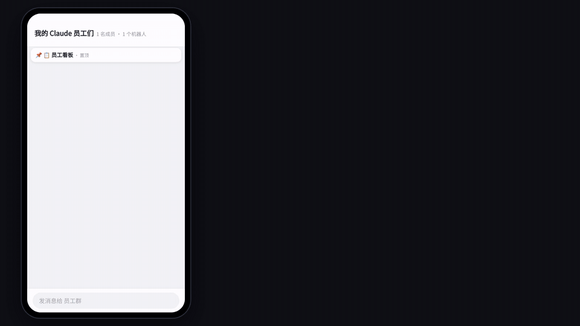

<div align="center">

# cc-crew

### Be the boss of your Claude Code crew, from your phone

Assign work, make the calls and approve permissions while you're away. Every employee is a real Claude Code session in your terminal, the same as if you were sitting at your desk.

[](LICENSE)


[简体中文](README.md) · **English**



<sub>Left: the Feishu group on a phone. Right: four Claude Code sessions in tmux on a server. <a href="docs/demo.mp4">HD mp4</a> (an animated mock-up; the cards look the same as the ones cc-crew sends).</sub>

</div>

## The problem

You run several Claude Code sessions at once, each on its own task. Once you leave the desk:

- **You can't tell who's done and who's stuck.** One is waiting for you to pick A or B. Another is waiting for "Allow". They wait all afternoon.
- **New work has to wait until you're back.** You think of something on the subway and can only write it down.
- **Notifications are all or nothing.** Either you hear nothing, or your phone never stops buzzing.

cc-crew turns each Claude Code session into an employee with a badge number in a Feishu group chat. One more Claude Code session acts as your secretary. You're the boss.

## Quick start

```bash
git clone https://github.com/Mutual-Luo/cc-crew.git
cd cc-crew
python install.py          # Windows: py -3 install.py
```

1. Create a bot app on the Feishu open platform (5 minutes, [steps below](#creating-the-feishu-app)) and enter its App ID and App Secret when the installer asks.
2. Send the bot any message in Feishu, then run `cr 授权` and `cr start`. From then on it only obeys you.
3. Start sessions with `ccm` instead of `claude` (same arguments), or just run `claude` inside tmux. The group chat appears by itself.

> **Rather not do it yourself?** Paste this to your Claude Code:
> `Install cc-crew for me by following https://github.com/Mutual-Luo/cc-crew/blob/main/INSTALL.md`

## A day with cc-crew

**Morning commute.** Open Feishu and look at the pinned 📋 employee board:
- #1 finished the baseline;
- #2 is editing the paper;
- #3 🙋 needs a decision from you.

Tap 〔B〕 on #3's card, and the Claude Code session on the server carries on.

**Between meetings.** #1 wants to install a package and a 🔐 card arrives; tap 〔Allow once〕. Tell the secretary "hire someone to get repo-x's tests passing". It opens #5 in tmux and assigns the work. #5's card shows, live, which file it read, which command it ran and how long it has been working.

**Evening.** `@1 下班` (clock out): #1 exits cleanly and keeps its conversation. Tomorrow, `上班 1` (clock in) resumes it in the same directory. At night only decisions reach you; everything else waits for you on the board.

## Features

- 🧑‍💼 **Secretary.** Plain messages go to the secretary: "clock out #3", "ask #5 how it's going", "hire someone to do X".
- 📣 **Direct orders.** `@3 …` goes to #3. Quote-reply a card to talk to that employee. `@所有人 …` (@everyone) holds a meeting.
- 🙋 **Decisions become buttons.** These include:
  - A/B/C options;
  - yes/no;
  - multi-select (tick, then submit);
  - Allow/Deny.

  One tap answers for you.
- ⏳ **Live progress.** Every step, a ticking timer, thinking effort, context usage and the 5-hour / weekly quota are on the card. When the work is done, the card becomes the reply in place.
- 📋 **Employee board.** One pinned card shows who's working, idle or waiting for you. "Still waiting" updates only touch the board.
- 🌙 **Quiet.** One employee's reports within 10 minutes merge into one card, so your phone buzzes once. At night only decisions are pushed. Night hours are learned from when you usually use Claude.
- 🗂 **HR.** Clock out (conversation kept), clock in (resume in place), fire, and let employees message each other.
- 🖥 **Remote terminal.** View the screen, press keys, stop, change effort, and run `/compact` with a progress card. `/model` menus become buttons.
- 🔌 **Survives reboots.** After a restart you're told how long it was down. Messages you sent meanwhile are listed for you to resend or skip. One tap brings every employee back.

## Why "real Claude Code"

cc-crew doesn't call the API or run headless, and it never reads or forwards your login credentials. Employees are the interactive Claude Code sessions you start in your terminal. The bot does what you'd do at the desk: read the screen, type and press keys.

So:

- Your `CLAUDE.md`, skills, hooks, MCP servers and permission settings all keep working.
- Back at your desk, `tmux attach` and you're in the same session, with everything you did from the phone.
- Usage counts against your subscription exactly as if you'd typed it yourself.

### How it compares

| | Good for |
|---|---|
| Claude Code's official Remote Control / Channels | Continuing **one** session in the Claude app, Telegram, etc. |
| IM bridges such as cc-connect and botmux | Chatting with AI CLIs from messaging apps; they support more IMs and agents |
| Terminal multiplexers such as claude-squad | Managing several sessions while at your desk |
| **cc-crew** | Managing a **whole crew** of long-running Claude Code sessions from a Feishu group while you're away: badges, a board, a secretary, decision buttons, merged notifications and quiet hours |

They work together, for example claude-squad at the desk and cc-crew on the go.

## Platforms

| OS | How to start Claude so it can be controlled | Status |
|---|---|---|
| Linux | Run `claude` inside tmux, or use `ccm` instead of `claude` | Used daily |
| macOS | Same (`brew install tmux`) | Experimental |
| Windows (PowerShell / Windows Terminal / VS Code terminal, no WSL) | Use `ccm` instead of `claude` | Experimental |

Sessions started with a plain `claude` still send progress, reports and decision cards; you just can't type into them remotely. `ccm` takes exactly the same arguments and looks the same as `claude`. It runs claude in a pseudo-terminal and opens a localhost-only port with a random token, so the bot can read the screen and type.

## Creating the Feishu app

<details>
<summary>One app per computer (one app connected to two computers only delivers to one of them). Click for the steps.</summary>

Go to the [Feishu open platform](https://open.feishu.cn/app), create a custom app (企业自建应用) and add the Bot capability. Then:

- Under 权限管理 (permissions), grant these with **app identity**:
  - `im:message`: send messages as the app
  - `im:message.p2p_msg:readonly`: read direct messages sent to the bot
  - `im:message.group_msg`: read all group messages (otherwise every message must @ the bot)
  - `im:message:readonly`: read chat history (used to catch up after a restart)
  - `im:chat`: create the group and pin the board
  - `im:resource`: send and receive images and files
- Under 事件与回调 (events & callbacks), choose **long connection**. Add the event `im.message.receive_v1` and the callback `card.action.trigger`.
- Publish a version.

The installer then does the following:
1. creates a venv and installs dependencies;
2. asks for the App ID, App Secret and group name;
3. adds two hooks and a status-line command to Claude Code's `settings.json` (your original status line still shows, and the file is backed up first);
4. enables start-at-login and starts the bot.

Add `cc-crew/bin` to PATH to use `cr` and `ccm` anywhere.

</details>

## Commands

| Command | What it does |
|---|---|
| `ccm [claude args…]` | Use instead of `claude` so the bot can control the session |
| `cr start` / `cr stop` / `cr status` | Start (with a watchdog that restarts it), stop, show status and logs |
| `cr autostart on` / `off` | Start at login: the Startup folder on Windows, a LaunchAgent on macOS, a systemd user service or crontab on Linux |
| `cr 看看`, `cr @3 …`, `cr 下班 3`… | Same as saying it in Feishu; the secretary uses these |

Configuration (`config.env`) is documented in the [Chinese README](README.md#常用命令).

## FAQ

**Can this get my account banned?** cc-crew only reads the screen and types for you, in the interactive Claude Code you logged into yourself. It doesn't call the API, run headless or touch credentials. We can't make any promises on Anthropic's behalf, so use it according to your own reading of the terms.

**Does it conflict with the official Remote Control?** No. Remote Control continues one session in the Claude app; cc-crew manages many from a Feishu group.

**Two computers?** Create one Feishu app and one group per computer.

**Cost?** cc-crew is free and open source. Claude Code uses your existing subscription, and Feishu custom apps are free.

**What if Feishu disconnects?** Employees keep working. Messages you sent during a short disconnect (up to 30 minutes) are replayed once the bot reconnects, and marked as caught up. After a long shutdown they're listed for you to decide.

## Security

- The bot only handles messages and button taps from one account (`FEISHU_ALLOW_OPEN_ID`). If someone else is added to the group, you're warned.
- Only you can confirm firing an employee in Feishu; the secretary can't.
- `ccm`'s control port listens on 127.0.0.1 only, with a random per-session token that stays in the local data directory.
- No identity information (Feishu name, open_id…) is ever sent to Claude.

## Roadmap

- [x] Feishu
- [ ] Lark (international Feishu)
- [ ] Slack
- [ ] Create the Feishu app by scanning a QR code

Issues and PRs welcome. If it's useful to you, a ⭐ helps others find it.

## License

MIT
